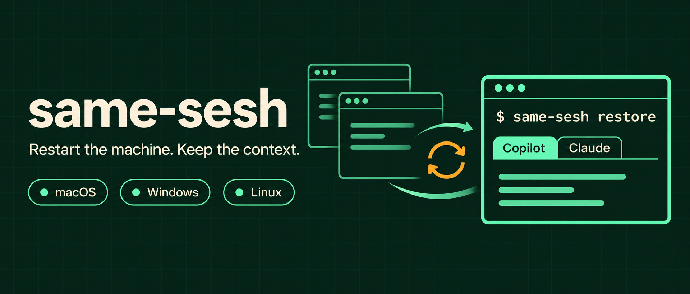

# same-sesh

**Reopen your AI terminal sessions after a restart on macOS, Windows, or Ubuntu on WSL2.**

Your coding assistant keeps the conversation. same-sesh remembers which
conversations were open, where you were working, and the last prompt when it’s
available. A background watcher saves that information about every 30 seconds.
After a restart, one command reopens the sessions it can identify.



## Quick start

With a GitHub account that has access, clone the repository and open the checkout
in the terminal you want to use.

```sh
git clone git@github.com:moonbox3/same-sesh.git
cd same-sesh
```

| | macOS (preview) | Windows |
| --- | --- | --- |
| Terminals | cmux, Terminal.app, iTerm2, Ghostty | Windows Terminal |
| Start saving automatically | `./same-sesh setup` | `.\same-sesh.cmd install` |
| See the saved sessions | `same-sesh` | `.\same-sesh.cmd` |
| Preview restore | `same-sesh restore --dry-run` | `.\same-sesh.cmd restore -DryRun` |
| Restore | `same-sesh restore` | `.\same-sesh.cmd restore` |

On **macOS**, guided setup detects installed terminals, remembers your selection,
and checks that the watcher can capture sessions. It installs a native copy in
`~/.local/share/same-sesh` and a command in `~/.local/bin`. If your current shell
can’t find it yet, follow the PATH instruction printed by setup or use
`./same-sesh` from the checkout. Terminal.app, iTerm2, and Ghostty may prompt for
Automation permission on restore. cmux requires socket access for automation.

On **Windows**, install starts the watcher and registers it to run at login.
Keep the checkout in place. You can run `same-sesh.cmd` from PowerShell 7,
Windows PowerShell, or Command Prompt. The launcher uses Windows' built-in
`powershell.exe` for the script and background watcher.

### Ubuntu on WSL2 (preview)

Run these commands **inside Ubuntu**, from a checkout in the Linux filesystem.
Use Ubuntu's `python3` and the Linux Copilot CLI, not a Windows binary
launched via WSL interop. Run Copilot in a Windows Terminal tab running WSL,
or in tmux. Direct Windows Terminal tabs do not need tmux.

```sh
./same-sesh install
./same-sesh status
./same-sesh restore --dry-run
./same-sesh restore
```

`install` enables a systemd user timer. It doesn't keep the WSL distro running;
after Ubuntu starts again, the timer resumes saving. If you don't have a
systemd user manager, use `./same-sesh watch` in a separate terminal instead.
Keep the checkout in place while the timer is installed.

By default, capture includes direct Windows Terminal Copilot sessions and the
current or default tmux server. Set `SAME_SESH_TMUX_SOCKET` to an absolute
socket path to capture only that tmux server. `install` remembers a selected
socket; install from outside tmux to watch both hosts.

Restore opens direct sessions in Windows Terminal (requires WSL interop) and
tmux sessions in new tmux windows. Unidentified Copilot conversations open
the picker. If you set `COPILOT_HOME`, direct capture uses only that home;
use the same setting to restore sessions saved with a custom home.
VS Code's integrated terminal, Claude Code, and Codex are not supported
by the WSL preview.

## Session support

| Session | macOS | Windows |
| --- | --- | --- |
| Claude Code | Exact resume when same-sesh identifies the session. Otherwise, opens the picker. | Exact resume when same-sesh identifies the session. Otherwise, continues the latest conversation in that folder. |
| GitHub Copilot CLI | Exact foreground session when identifiable. Otherwise, opens the picker. | Same. |
| Codex CLI | Reopens the working folder and launches the Codex session picker. | Uses the session ID when visible in a running `codex resume <id>` command. Otherwise, opens the picker. Exact restore is unverified. |
| Shell or other command | Reopens the folder and displays what was running. | Same. |

On macOS, same-sesh captures one selected terminal app. Restore opens a new cmux
workspace or native terminal window for each entry. Windows opens tabs in one
Windows Terminal window. Tools redraw their own conversation history on resume.
Pane layout and scrollback are outside the snapshot.

## Everyday commands

Use the platform command shown above with these arguments.

| Command | What it does |
| --- | --- |
| `snapshot` | Save the current sessions immediately. |
| `history` | List snapshots, numbered from newest at index 0. |
| `restore --index N` / `restore -Index N` | Restore a specific snapshot on macOS or Ubuntu / Windows. |
| `watch` | Save periodically in the current terminal until stopped. |
| `uninstall` | Remove automatic saving and keep the snapshots. |
| `status` | Show whether the watcher is running and when the last snapshot was saved. On Windows, run `.\same-sesh.cmd status`. |
| `pause`, `resume` | On macOS, pause or resume automatic saving. |

Restore skips identifiable sessions that are already open. The first restore
after a new login or WSL distro restart prefers the previous instance's snapshot. Empty
captures preserve the last saved sessions. Use `snapshot` before restarting if
you just opened a session and want to save it immediately.

## Local data and restore

Snapshots live in `~/.same-sesh`; on Linux, timer errors go to the user journal
(`journalctl --user -u same-sesh.service`). Snapshots can contain
working paths, session IDs, titles, and parts of your prompts. Keep them private.
On Linux, use a user-owned private directory (mode `0700`) for
`SAME_SESH_STATE_DIR`. The state path and its `history` directory cannot be symlinks.
The shared JSON format works across platforms, but saved folders must make
sense on the machine where you restore.

Restore builds commands for supported tools from the tool name and session ID.
Other recorded commands are shown as text. On macOS, restoring a session with a
custom tool home requires the corresponding `COPILOT_HOME` or
`CLAUDE_CONFIG_DIR` to be set in the shell running same-sesh.

## macOS installer options

From the checkout, `./install.sh` runs guided setup. The optional npm launcher
uses Node only to start setup. You can try it locally with
`npm exec --yes --package=. -- same-sesh setup`. The npm package is unpublished.

For a GitHub release with a standalone `same-sesh` asset, run
`./install.sh --release VERSION SHA256` with the expected digest from the
trusted release announcement. The installer verifies the download before running it.

## Development

- macOS: `./macos/same-sesh.tests.js`
- Windows: `powershell.exe -NoProfile -ExecutionPolicy Bypass -File .\windows\same-sesh.tests.ps1`
- Ubuntu: `python3 linux/same-sesh.tests.py`

Live close-and-restore was verified for Claude and Copilot in cmux and for
Copilot in Terminal.app, iTerm2, and Ghostty. An actual macOS logout and login
test is pending. On Ubuntu 24.04 under WSL2, two Copilot conversations in the
same directory were restored by ID after a distro restart. Other Linux
distributions haven't been verified. See [AGENTS.md](AGENTS.md) for adapter guidance.
